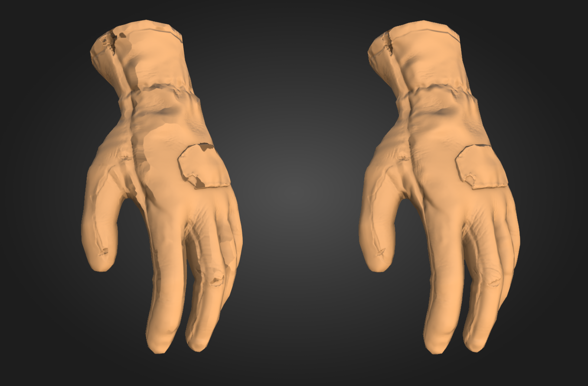

# Pintura en jaula

**Pintar la jaula** te permite separar las áreas de pintura para alejar más la jaula que hace un bake o acercarla a la superficie de bajo contenido de poli. La pintura en jaula ayuda a evitar artefactos durante el haga un bake mientras sigue capturando todos los detalles de alto contenido polivinílico de la malla.

*El guante izquierdo, hecho un bake con una jaula basada en la distancia y una distancia frontal máxima baja, muestra artefactos que hacen un bake, como la distorsión y las áreas donde la jaula se cruza con la malla de alta polietileno, perdiendo detalles. Se hizo un bake el guante correcto con la misma configuración, pero con un cuadro de jaula para controlar el tamaño de la jaula.*

>[!NOTE]
>
> La pintura de la jaula subdivide automáticamente la malla de la jaula, lo que significa que incluso con mallas de baja resolución, la jaula se puede empujar y tirar lo suficiente para cubrir todos los detalles.

## Configurar la pintura en jaula

Para que **Cage painting** esté disponible, el proyecto debe tener al menos un archivo de escena High-Poly desde el que hacer un bake, y el tipo Cage debe establecerse en **Distance-based**.

>[!NOTE]
>
> En una futura versión, se agregará compatibilidad con **Pintura de jaula** para el **Tipo de jaula automática**.

Se recomienda establecer los valores **Distancia frontal máxima** y **Relativa al cuadro delimitador** antes de comenzar a realizar la pintura de la jaula, ya que cambiar estos valores después de pintar puede requerir retoques o incluso volver a pintar la jaula desde cero.

>[!TIP]
>
> Si desea volver a empezar a pintar la jaula desde cero, restablezca los parámetros de pintura de la jaula, los trazos de pintura de la jaula o todos los ajustes de hace un bake.
>
> 

## Inicio de la pintura en jaula

Para iniciar la pintura en jaula:

1. Cambiar a [**modo de Hacer un bake**](baking.md).
1. Asegúrese de haber seleccionado al menos un archivo **High-poly scene** desde el que hacer un bake.
1. En **Configuración común** **panel**, vaya a la **sección de la jaula**.
1. Establezca el **Tipo de jaula** en **Basado en distancia**.
1. Haga clic en **jaula de Pintura**.

>[!VIDEO](https://video.tv.adobe.com/v/3504611?learn=on)

*Este vídeo muestra un nuevo proyecto que se está configurando para pintar en jaula. Primero cambiamos al modo de hacer un bake y, a continuación, seleccionamos una escena de alta poliéster. El tipo de jaula basada en la distancia está seleccionado de forma predeterminada, por lo que podemos empezar a pintar la jaula inmediatamente.*

>[!NOTE]
>
> De forma predeterminada, **Volver a hacer automáticamente** está activado para el canal normal cuando se entra por primera vez en **Pintura en jaula**. Esto significa que el mapa de normales se vuelve a hornear automáticamente cada vez que modifica la jaula. Activar o desactivar **Reprocesamiento automático** en el [**panel bakeres de mapa de malla**](../interface/baking-panels/mesh-map-bakers.md).
>
> 

Una vez que entre en el modo de pintura en jaula, la visualización predeterminada en la **Ventana gráfica** muestra:

* La jaula alrededor de la malla en color beige transparente.
* Áreas donde el poli alto intersecta la jaula en rojo brillante.
* Áreas pintadas en jaula en verde (positivo) y azul (negativo) en la superficie de malla de bajo contenido de poli.

En el modo de pintura en jaula, usa el [**menú de visualización de Haga un bake**](baking-visualization-settings.md) en la **Ventana gráfica** para personalizar la forma en que se visualiza cada elemento.

>[!NOTE]
>
> La visualización en rojo brillante de las intersecciones de alta polietileno con la jaula es una previsualización aproximada y no coincide exactamente con los resultados finales de hago un bake. En la mayoría de los casos, la visualización es bastante precisa, pero para mallas de bajo contenido de poli con polígonos largos y delgados, puede ser inexacta. Para estas mallas, es mejor usar **Haga un bake rápido** o **Auto-Rebake** para comprobar el resultado final.

## Herramientas de pintura en jaula

Al pintar la jaula, puedes usar muchas de las herramientas y métodos abreviados a los que estás acostumbrado en el **modo de pintura**, incluidas las herramientas **Pincel**, **Borrador** y **Relleno poligonal**.

* Puedes cambiar entre **Pincel**, **Borrador** y **Relleno poligonal** en la barra de herramientas, o usar los [métodos abreviados de teclado](../interface/settings/shortcuts.md) estándar del modo de pintura.
* Al usar las herramientas **Pincel** o **Borrador**, puede ajustar el tamaño, flujo, opacidad y espaciado de la herramienta mediante los parámetros situados en la parte superior de la **Ventana gráfica**. También puede usar los [métodos abreviados de teclado](../interface/settings/shortcuts.md) relevantes donde estén disponibles.

### Pincel

El uso del **Pincel** con **Intensidad**, **Flujo** y **Opacidad** tiene un gran impacto en la superficie de la jaula. Se recomienda establecer un valor muy bajo de **Intensidad** y utilizar los parámetros Flujo y Opacidad para controlar la intensidad del pincel.

*En este ejemplo, el primer trazo de pincel es demasiado fuerte, incluso con un valor de intensidad de 0,05. Después de reducir la opacidad de intensidad, flujo y trazo, tenemos mucho más control sobre el efecto.*

### Borrador

La herramienta Borrador le permite eliminar la pintura de la jaula, lo que revertirá de forma efectiva las áreas borradas al tamaño de jaula predeterminado.

### Relleno poligonal

En **Modo de pintura en jaula****3}, la** herramienta Relleno poligonal **tiene una característica adicional, un regulador de** Intensidad **aparece en la** Ventana gráfica **al realizar cambios que puede usar para ajustar el valor del último conjunto de polígonos seleccionados.**

Esta función es especialmente útil para realizar ajustes por elemento con **Modo de relleno de malla** en escenas con varias mallas independientes.

>[!NOTE]
>
> Esta función vuelve a realizar la última operación (aplicar el relleno de polígono) con un valor de intensidad diferente. Como resultado, realizar una operación diferente o cambiar las herramientas hace que el regulador desaparezca.

A menudo es útil aplicar el mismo valor de pintura de jaula a varias áreas de la malla. Para ello:

1. Seleccione el primer conjunto de polígonos.
1. Utilice el regulador **Intensidad de la jaula** para ajustar la intensidad del efecto.
1. Copie el valor de **intensidad de la jaula** del regulador temporal en la **Ventana gráfica**.
1. Pegue el valor en el regulador **Intensidad** situado en la parte superior de la **Ventana gráfica**.
1. Seleccione los conjuntos de polígonos siguientes para aplicar el mismo valor de intensidad.

El vídeo siguiente muestra este flujo de trabajo en acción, usando la **herramienta** Relleno poligonal **con la opción** Relleno de malla **seleccionada.**

>[!VIDEO](https://video.tv.adobe.com/v/3504621?learn=on)

>[!NOTE]
>
> Al seguir estos pasos, puede resultar útil seleccionar **Modo de fusión normal** para que la herramienta Relleno poligonal sobrescriba los valores pintados existentes, en lugar de agregarlos.

### modos de Fusión

De forma predeterminada, las herramientas **Pincel** y **Relleno poligonal** tienen como valor predeterminado el **modo de fusión (agregar)**, pero también puedes usar los modos de fusión **Normal** y **Aclarar (máx.)**.

* **Sobreexposición lineal (agregar)**
  * Cada trazo/sello añade o resta el valor de intensidad dado del valor existente.
  * Este modo de fusión funciona de forma similar a las aplicaciones de esculpido 3D, donde cada trazo que se pintura se añade a la superficie de la malla.
* **Normal**
  * Cada trazo o sello establece el valor en la intensidad especificada, sobrescribiendo el valor existente.
  * Este modo de fusión se comporta como el pincel predeterminado en el modo de pintura, lo que le permite cubrir la superficie existente con un valor diferente.
* **Aclarar (máx.)**:
  * Cada trazo/sello selecciona el valor máximo entre la intensidad y el valor existente.
  * Con este modo de fusión, los bordes del pincel tardan más en crearse a partir de trazos posteriores, lo que ayuda a crear una transición más gradual.