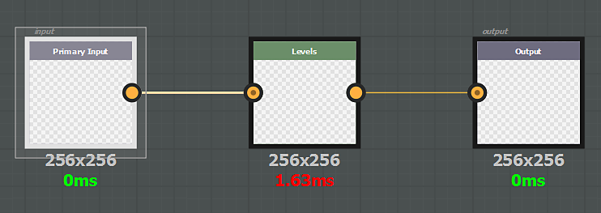

# Filtro genérico

Se aplicará un efecto genérico en todos los canales del documento, incluida la opacidad. Un filtro genérico puede ser:

* **escala de grises**, se aplicará a cada componente (R, G, B y A) de cada canal (color base, metálico, rugosidad, etc.)
* **color**, se aplicará en el canal en color tal cual o se convertirá internamente a escala de grises para afectar a los canales en escala de grises

El nodo de entrada del efecto debe tener **identificador** o **uso** definido **entrada** y su nodo de salida debe tener **salida**. Tenga en cuenta que los filtros basados en **color** no se pueden usar en la máscara de una capa, solo los filtros de **escala de grises** serán compatibles.

>[!NOTE]
>
> Es posible usar **usage** o **identificador** en un nodo de entrada (el uso tiene la prioridad).

Ejemplo :

{width="575px"}
