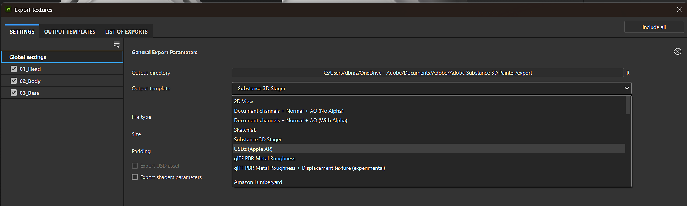
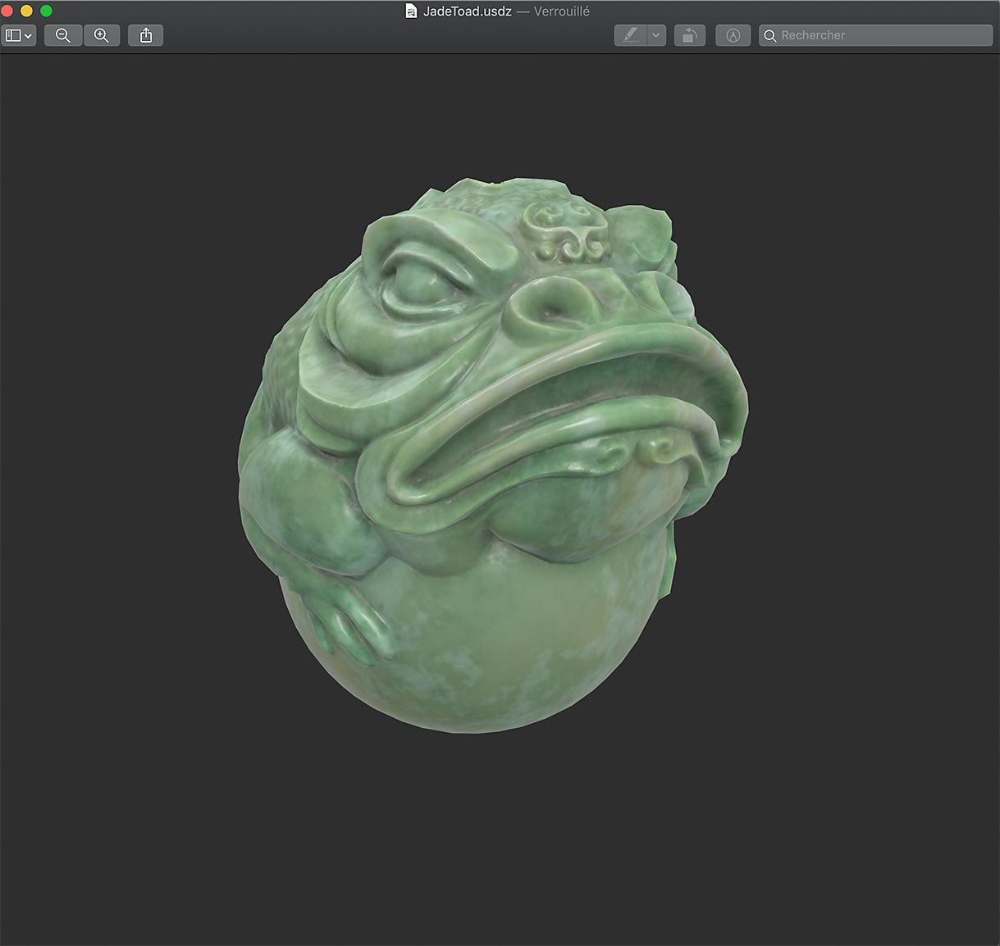
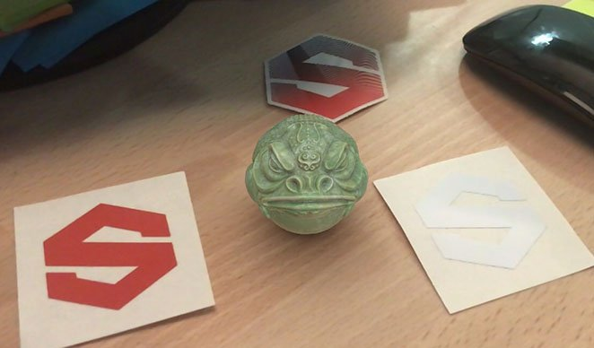

# Plantilla predefinida USDz (Apple AR)

>[!NOTE]
>
> Para exportar a USD con una Plantilla de salida personalizada, no utilice la plantilla USDz (Apple AR). En su lugar, usa la Plantilla de salida que desees y habilita <b>Exportar USD recurso</b> en la parte inferior de la <b>pestaña Configuración</b>.

La plantilla de salida predefinida USDz (Apple AR) exporta el recurso configurado para su uso con aplicaciones Apple AR.

Para utilizar la plantilla USDz (Apple AR):

1. Abra la ventana de exportación con <b>Archivo > Exportar texturas</b> o con el método abreviado <b>Ctrl + Mayús + E</b>.
1. En la <b>pestaña Configuración</b>, abre la <b>lista desplegable de Plantillas de salida</b> y selecciona <b>USDz (Apple AR)</b>.

{zoomable="yes"}

Se crean y se guardan cinco archivos de textura (color base, metálico, normal, oclusión y rugosidad). Todos los archivos se guardan como JPG, excepto el mapa de normales, que se guarda como PNG para evitar artefactos debido a la compresión con pérdida.

Además, se crean otros dos archivos con la extensión usdc y usdz:

A continuación se muestra un ejemplo del JadeToad abierto directamente en MacOS desde Finder:

{width="400px"}

A continuación se muestra un ejemplo del archivo USDZ enviado a un iPhone, utilizando el modo AR para colocar el modelo JadeToad en un entorno real:

{width="500px"}
