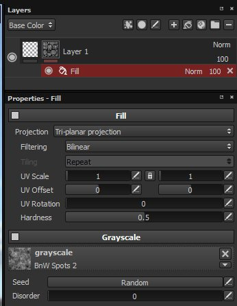

# Relleno

Los efectos de relleno son iguales que los de una capa de relleno, pero se pueden aplicar como efectos en una capa o una máscara, lo que permite crear materiales o máscaras más complejos en una sola capa.

