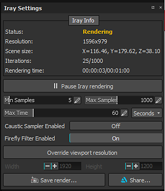
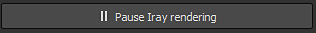

# Configuración de Iray

La configuración de Iray controla el procesamiento de la ventana gráfica de IRay, cuánto tiempo se ejecutará y la calidad de la misma.

## Información sobre Iray

En la parte superior de la ventana se muestra el estado de Israel junto con otra información.

| *Configuración* | *Descripción* |
| --- | --- |
| **Estado** | El estado indica cómo está trabajando Iray :<ul data-preserve-html="true"><li data-preserve-html="true"><strong>Procesando</strong> (Iray está calculando la imagen)</li><li data-preserve-html="true"><strong>En pausa</strong> (Iray se ha calculado pero no ha finalizado)</li><li data-preserve-html="true"><strong>Listo</strong> (cálculo de Iray finalizado o alcanzado los valores de configuración)</li></ul> |
| **Resolución** | La resolución de la imagen de Iray (que depende por defecto del tamaño de la ventana gráfica). |
| **Tamaño de escena** | El tamaño del cuadro delimitador de la escena/malla 3D. No hay unidad, pero se supone que está en centímetros. |
| **Iteraciones** | El número de pases de cálculo realizados por Iray por encima del máximo definido en la configuración. |
| **Tiempo de procesamiento** | Tiempo transcurrido al realizar un procesamiento durante el tiempo máximo definido en los ajustes. |

>[!NOTE]
>
> El número de iteraciones definirá la calidad final del renderizado : más iteraciones = mejor calidad.\
> Sin embargo las iteraciones pueden tomar algún tiempo, por eso es posible definir un tiempo máximo. Una iteración se define por el número de muestras.

## Configuración

Tan pronto como se haya modificado una configuración, Iray comenzará a calcular el procesamiento.\
Es posible pausar a Iray para evitar este comportamiento con el botón dedicado :

| *Configuración* | *Descripción* |
| --- | --- |
| **Ejemplo Mínimo** | Cantidad mínima de muestras realizadas por píxeles |
| **Ejemplo Max** | Cantidad máxima de muestras realizadas por píxeles |
| **Tiempo máximo** | El tiempo máximo permitido para que Iray haga su cómputo.  El menú desplegable de la derecha permite ajustar la unidad (segundos, minutos u horas). |
| **Sampler cáustico habilitado** | Esta opción permite calcular reflejos de iluminación más avanzados (cáusticos). |
| **Filtro de Firefly habilitado** | Esta opción permite deshacerse de los píxeles aislados y muy brillantes que pueden suceder a veces. |
| **Omitir resolución de ventana gráfica** | Esta configuración permite definir un tamaño personalizado para el procesamiento, en lugar de utilizar el tamaño actual de la ventana gráfica. La configuración **Anchura** y **Height** que aparece a continuación permite definirla en una cantidad de píxeles. |
| **Guardar procesamiento** | Acción para exportar el procesamiento actual (incluso si no está terminado) a un archivo. |
| **Compartir** | Permita compartir o exportar el procesamiento actual a [ArtStation](https://www.artstation.com/). |
