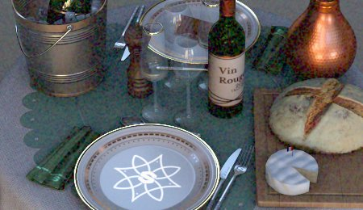

# Película granulada

Añade un patrón de película granulada acústica a la imagen, simulando la textura orgánica de la película fotográfica analógica.

| <b>Parámetro</b> | <b>Descripción</b> |
| --- | --- |
|  |  |
| --- | --- |
| <b>Importe</b> | Controla la visibilidad y la intensidad del grano. Los valores más altos producen un ruido más prominente y perceptible. |
| <b>Radio</b> | Define el tamaño de las partículas de grano individuales en píxeles. Los valores más pequeños crean un grano más fino y más sutil; los valores más altos producen una textura más gruesa y visible. |
| <b>Tipo</b> | Selecciona entre ruido monocromático o de color. |

>[!NOTE]
>
> El ruido generado por este efecto se vuelve a generar cada vez que se actualiza la ventana gráfica. Por eso, cuando se generan sombras o cuando se gira la cámara, el ruido puede actualizarse.
