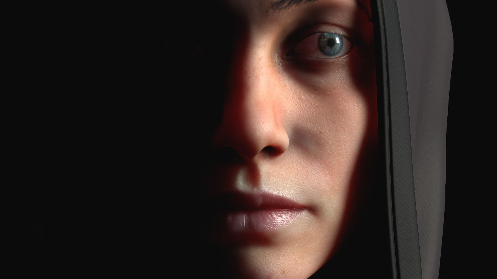

# Dispersión de subsuperficie

{width="500px"}

>> 

(Créditos : El soldado, [por Ribeyrolles Leo](https://www.artstation.com/artwork/xNYDm) )

Substance 3D Painter admite la dispersión subsuperficial **Subsurface** tanto en su **área de visualización en tiempo real** como en el [Procesador Iray](../../features/iray-renderer/iray-renderer.md) .

La dispersión subsuperficial es un mecanismo de la luz cuando se penetra en un objeto o una superficie. En lugar de reflejarse, como las superficies metálicas, el material absorbe una parte de la luz y luego la **dispersa dentro** . Este comportamiento se conoce a menudo con el acrónimo **SSS** para &quot;**S** ub **S** superficie **S** cattering&quot;. Muchos materiales en la vida real tienen dispersión subsuperficial como la piel o la cera.

Para obtener más información, consulte las siguientes páginas:

* [Activación de la subsuperficie en un proyecto](enabling-subsurface-in-a-project.md)
* [Parámetros de subsuperficie](subsurface-parameters.md)
* [Tipo de material de subsuperficie](subsurface-material-type.md)
