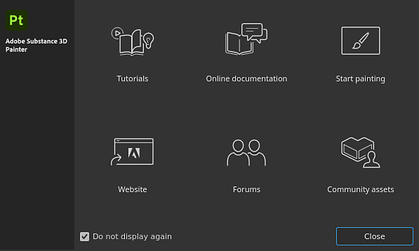

# Procedimientos iniciales

Desde la ventana de <b>pantalla de bienvenida</b>, puedes acceder a las siguientes páginas:

* [Tutoriales](https://www.adobe.com/go/substance3dpaintertutorials_es)
* Documentación en línea (¡Ya está aquí!).
* Empezar a pintar: cargue el proyecto de muestra &quot;Meet Mat&quot;.
* [Sitio web](https://www.adobe.com/creativecloud/3d-augmented-reality.html)
* [Foros](https://community.adobe.com/t5/substance-3d-painter/bd-p/substance-3d-painter?filter=all&page=1&sort=latest_replies)
* [Activos de la comunidad](https://helpx.adobe.com/substance-3d-community-assets/home.html)

De lo contrario, puede empezar a usar los conceptos básicos de creación de proyectos y exportación de texturas:

* [Creación de proyectos](project-creation.md)
* [Exportar](../export/export.md)
* [Glosario](glossary.md)
* [Rendimiento](../technical-support/performances-guidelines/performances-guidelines.md)
* [Activación y licencias](activation-and-licenses.md)
* [Requisitos del sistema](system-requirements.md)

Para acelerar el flujo de trabajo, consulte la lista de métodos abreviados:

* [Mét. abreviados](../interface/settings/shortcuts.md)

{width="500px"}
