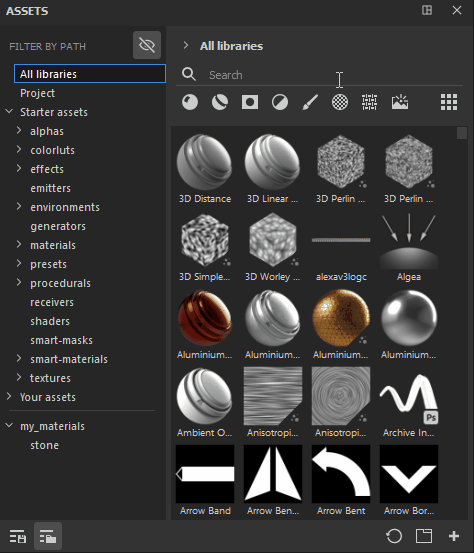

# Filtrar por ruta

**Filtrar por ruta** es una sección adicional que se puede usar para navegar por los activos. Tiene la misma estructura que las rutas de navegación, lo que significa que le permite ver la ruta o la ubicación de sus activos.

De forma predeterminada, se activa la opción **Ocultar carpetas no aplicables**, lo que le permite ocultar carpetas vacías de la interfaz de usuario. Esto puede resultar útil si, por ejemplo, combina Filtro por ruta con una palabra de búsqueda específica o selecciona un tipo de activo, ya que solo podrá ver las ubicaciones relevantes que contengan su búsqueda.

