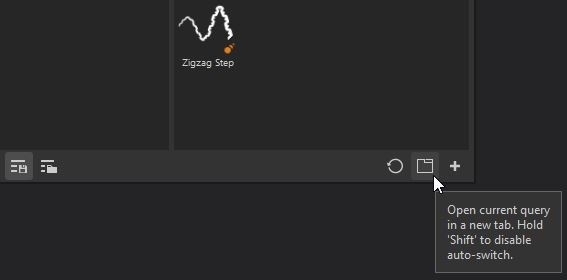

# Ficha Subbiblioteca

Una subbiblioteca es una nueva pestaña o ventana de Substance 3D Painter dedicada a una búsqueda específica.\
No hay ninguna ficha de subbiblioteca abierta de forma predeterminada, solo la ventana principal Activos. Puede crear pestañas de subbiblioteca desde la ventana principal Activos mediante dos métodos:

* Haciendo **clic con el botón derecho** en una de las búsquedas guardadas y eligiendo **Crear nueva pestaña.**

* **eligiendo o introduciendo una consulta de búsqueda** (a través de tipos de activos, rutas de navegación, consulta de texto o filtro por ruta de acceso) y luego usando el **botón** dedicado en la parte inferior de la ventana Activos.

Al crear una subbiblioteca, se creará automáticamente una nueva pestaña y **se acoplará** en la interfaz dentro del mismo espacio que la ventana principal de Activos.

Desde allí, la ventana de la subbiblioteca se puede acoplar en cualquier otro lugar o dejar flotante en cualquier lugar de la interfaz o en otra pantalla.

>[!NOTE]
>
> * Una subbiblioteca tiene las mismas características que la ventana principal Activos, sin embargo, cuando se restablezca, volverá a su consulta de búsqueda original.
> * A diferencia de la ventana Activo principal, si cierra una subbiblioteca, será necesario volver a crearla.
> * Si se elimina una búsqueda guardada, la ventana de subbiblioteca seguirá existiendo hasta que se cierre.
