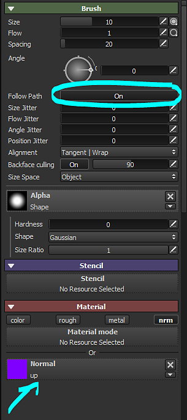
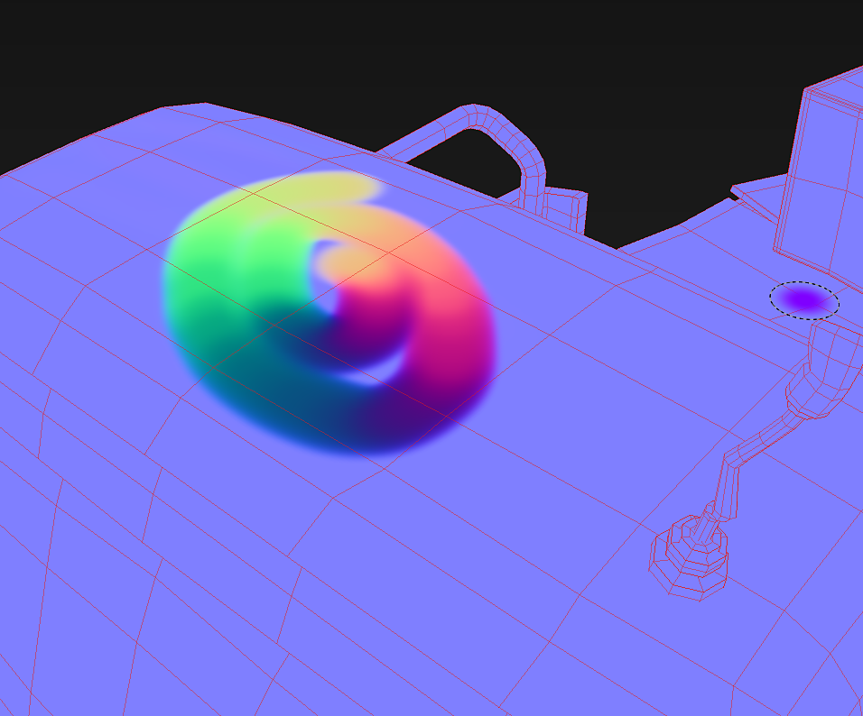

# Pintura de mapa de flujo

Se ha previsto un canal dedicado, pero mientras tanto, mediante el canal Normal y algunos parámetros de pincel es posible pintura de mapas de flujo en Substance 3D Painter.

## Paso 1 : Crear el mapa de normales

Cree una textura de mapa de normales de 16 por 16 píxeles. El color debe ser 128, 255, 128, que debe dar el siguiente color: \
(Este color es el equivalente a un vector que mira hacia arriba, en DirectX)

## Paso 2 : Añadir canal normal

En tu proyecto de Substance 3D Painter, añade un canal **Normal** mediante la **configuración del conjunto de texturas** si este canal aún no existe.

## Paso 3 : Configuración del pincel

Active la función Seguir trazado en los parámetros del pincel. Cargue la textura de mapa de normales (paso 1) en la ranura del canal normal. Deshabilite los otros canales.

{width="300px"}

## Paso 4 : ¡pintura!

Al pintar en la malla con el ajuste Seguir trazado activado, los trazos de pincel dibujarán direcciones hacia el mapa de normales.

{width="700px"}
