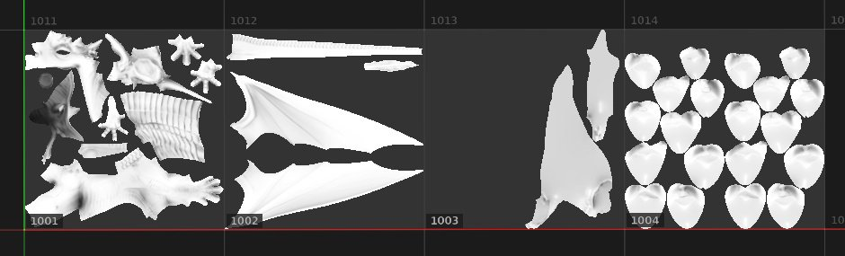

# Relleno (coincidencia por Mosaico de UV)

**Rellenar (coincidencia por Mosaico de UV)** es una proyección 2D especial que resulta útil para proyectos de [Mosaico de UV](../../features/uv-tiles/uv-tiles.md). Permite asignar una textura de UDIM de una secuencia para cada Mosaico de UV.

Esta proyección no tiene ningún ajuste específico, ya que se asigna una sola imagen o más para rellenar cada Mosaico de UV. Como no hay ajustes, este modo también es mejor para el rendimiento.

| Modo | Descripción |
| --- | --- |
| **Proyección de UV** | Una sola imagen o la primera imagen de una secuencia se aplica a todos los mosaicos UV. Esto también proporciona controles de deformación; consulte [Proyección de UV](uv-projection.md) para obtener más detalles. 

 |
| **Relleno (coincidencia por Mosaico de UV)** | Cada imagen de una secuencia se asigna al Mosaico de UV específico. No hay controles de deformación. 

 |
