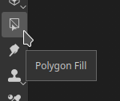

# Relleno poligonal

La herramienta **Relleno de polígono** rellena los polígonos con valores de canal de material o valores de máscara de escala de grises. Se puede utilizar en capas de pintura, efectos y máscaras para rellenar rápidamente regiones de la malla.

Esta herramienta es más una herramienta de pintura que una herramienta de selección: por esta razón, una vez que se ha utilizado, solo se puede borrar con la herramienta borrador o rellenando sobre ella.

Se puede acceder a la herramienta desde la barra de herramientas de herramientas:

## Configuración

A continuación se muestra la lista de opciones de configuración disponibles con la herramienta **Relleno poligonal** en la ventana **Propiedades**.

### Modo de selección

El modo de selección controla cómo se seleccionan los triángulos y cuadrantes de la geometría de malla.

| **Modo** | **Descripción** |
|---|---|
|  **Relleno de marco rectangular** | Dibuje una selección rectangular haciendo clic y arrastrando. **Modo de relleno** define qué geometría se rellena, mientras que **Prueba de aciertos** define qué polígonos se incluyen.    |
|  **Relleno de bucle de polígono** | Rellena un bucle completo de cuadrantes con un solo clic. Arrastrar selecciona varios bucles.    |
|  **Relleno de bucle de polígono parcial** | Rellene una parte de un bucle haciendo clic y arrastrando. La selección puede extenderse a lo largo de bucles secundarios para formar un parche de polígonos.    |

### Modo de relleno

El modo de relleno, que solo se puede usar con el modo **Relleno de marco rectangular**, controla qué partes de la geometría se seleccionan.

| **Modo** | **Descripción** |
|---|---|
|  **Relleno triangular** | Rellena triángulos de malla individuales. |
|  **Relleno poligonal** | Rellenar polígonos completos. En una malla triangulada antes de la importación, el resultado es el mismo que **Relleno triangular**. |
|  **Relleno de malla** | Rellena todos los polígonos conectados al que has hecho clic. |
|  **Relleno de fragmentos UV** | Rellenar polígonos conectados en el espacio UV. El relleno se detiene en los bordes UV. |

### Prueba-acierto

La configuración de comprobación de visitas controla cómo se seleccionan los triángulos y los cuadrantes mediante el modo **Relleno de marco rectangular**.

| **Modo** | **Descripción** |
|---|---|
|  **Intersección** | (valor por defecto) Un polígono se rellena si alguna parte de su geometría está dentro del área de selección o se cruza con ella. |
|  **Centro contenido** | Un polígono sólo se rellena si su punto central se encuentra dentro del área de selección. |
| **Solo polígonos visibles** | Si está activado, el relleno solo afecta a los polígonos visibles desde la vista de cámara actual. Los polígonos ocluidos y orientados hacia atrás se omiten. Si está desactivado, los polígonos se pueden rellenar a través de la malla. |

### Fusión

Esta configuración controla cómo se mezcla el resultado del relleno con los píxeles subyacentes.

| **Parámetro** | **Descripción** |
|---|---|
| Modo de fusión | Controla cómo se mezcla el relleno con los valores de píxeles existentes. En el modo **Material**, el modo de fusión se aplica a todos los canales habilitados en la sección **Material**. |
| Opacidad | Controlar la opacidad del relleno. |

>[!NOTE]
>
> La herramienta admite los mismos modos de fusión disponibles en la pila de capas. Para obtener más información, consulte la [página de documentación de modos de fusión](https://experienceleague.adobe.com/es/docs/substance-3d-painter/using/interface/layer-stack/blending-modes).

### Material

La sección de material controla qué canales se pueden activar para que la herramienta los pinte.

## Mét. abreviados

La herramienta Relleno poligonal se puede utilizar de forma eficaz con la ayuda de métodos abreviados de teclado específicos:

| **Método abreviado** | **Descripción** |
|---|---|
| **Alt** | Con el **relleno de bucle de polígono** y el **relleno de bucle de polígono parcial**, este método abreviado extiende la selección al otro lado del clic inicial mientras arrastra.    |
| **Mayús** | Con el **relleno de bucle de polígono parcial**, este método abreviado solo rellena el bucle principal, ignorando los bucles secundarios. Ejemplo de alternancia de **Shift**:    |
| **Mayús + A** | Este método abreviado cambia temporalmente a **Relleno de bucle poligonal** desde cualquier otro modo de selección. Si se suelta el método abreviado antes del botón del ratón, la selección continúa hasta que se suelta el botón del ratón. |
| **A** | Si se presiona este método abreviado mientras se arrastra, el resultado actual se combina con el resultado anterior. Esto funciona en todos los modos de fusión y opacidad:    |

## Limitaciones

Se aplican algunas limitaciones a la herramienta:

* **Relleno de bucle de polígono** y **Relleno de bucle de polígono parcial** solo funcionan en cuadrantes, de modo que los triángulos y los n-gones no se pueden rellenar con estos modos.
* La compatibilidad con **simetría radial** también es limitada y puede no ser confiable. Para usar la simetría, prefiera usar el modo espejo en su lugar. Consulte la [página de documentación de la simetría](https://experienceleague.adobe.com/es/docs/substance-3d-painter/using/painting/symmetry/symmetry) para obtener más información.
* La herramienta rellena la geometría solo del **conjunto de texturas activo**. La malla metálica se muestra para ese conjunto de texturas y se actualiza cuando cambia el conjunto de texturas activo.
