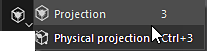
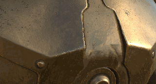

# Proyección

{width="50px"}

La proyección es una herramienta que permite la pintura de un material proyectándolo en el espacio de la pantalla/ventana gráfica. Comparte controles similares a la galería de símbolos.

Es posible editar la transformación de la proyección pulsando **método abreviado S** :

* Use **S + clic izquierdo del ratón** para rotar la galería de símbolos.
* Use **S + clic izquierdo del ratón + MAYÚS** para ajustar o restringir la rotación de la galería de símbolos.
* Utilice **S + clic con el botón derecho del ratón** para ampliar o reducir la galería de símbolos.
* Use **S + ratón central** para traducir la galería de símbolos.

<table>
<tr style="border: 0;">
<td style="border: 0;" valign="top">

</td>
<td style="border: 0;" valign="top">

</td>
<td style="border: 0;" valign="top">

</td>
</tr>
</table>

* **Proyección** : Herramienta de pintura basada en la proyección del espacio de pantalla. Esta herramienta mostrará y repetirá un patrón en la ventana gráfica.
* **Proyección física**: Herramienta de pintura de proyecciones con propiedades físicas basadas en ajustes preestablecidos de partículas.
