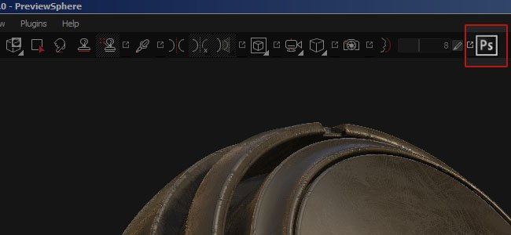

# Versión 2.3

**Substance Painter 2.3** mejoró la API de scripts para lanzar su primer plugin oficial : Exporte Photoshop con toda la pila de capas disponible.

Fecha de lanzamiento : *15 de septiembre de 2016*

## Funciones principales

### Nuevo plugin de exportación de Photoshop

Con esta versión, nos centramos en añadir nuevas posibilidades en la API de scripts para implementar **un exportador avanzado para Photoshop**. Para acceder a esta nueva exportación, simplemente haga clic en el icono de Photoshop disponible en la barra de herramientas principal (si el plugin está activado, que es el caso de forma predeterminada). El plugin permite exportar la pila de capas completa disponible en un conjunto de texturas y crear una estructura similar dentro de un archivo de PSD. Esta característica **requiere tener Photoshop instalado** en tu equipo para poder generar el archivo de PSD.

Algunas opciones están disponibles a través del botón configurar del menú de complementos :

## Tutorial

Nuestro último tutorial explica el proceso de exportación con el nuevo plugin :

## Notas de la versión

### 2.3.1

(Publicado el 7 de octubre de 2016)

**Agregado :**

* [Plugin] [Photoshop] Permite especificar qué material/pila/canales se van a exportar
* [Scripting] Los nombres de función tienen algunas incoherencias

**Solucionado :**

* [Export] El Alpha se puede descartar en los ajustes preestablecidos de exportación personalizados
* [Exportar] El Alpha obtiene una conversión de gamma incorrecta en canales sRGB
* [Exportar] Los documentos no cuadrados se exportan como cuadrados
* [Exportar] No es posible exportar mapas adicionales si falta uno
* [Iray] Algunos parámetros (como la Intensidad del emisivo) no tienen efecto
* bloqueo [NVIDIA] al inicio con NVIDIA Quadro K2200/GTX 750/760
* [AMD] Conjunto incorrecto de colores para miniaturas y vistas previas
* [AMD] Bloqueos y error del controlador al abrir archivos nuevos y abiertos
* [Log] Falta &quot;software-version&quot; en el archivo de registro

### 2.3.0

(Publicado el 15 de septiembre de 2016)

**Agregado :**

* [Plugin] Nuevo plugin &quot;Exportar a Photoshop&quot; (exportar pila de capas completa)
* [Exportar] Permite especificar la anchura del relleno (en píxeles o infinito)
* [Exportar] Permite definir el tipo de fondo fuera de las UV
* [Estante] sombreador de capas de material nuevo para mezclar 10 materiales
* [Estante] Nuevo sombreador de arcilla para ver los detalles con el height / canal normal
* [Estante] Nuevo filtro de iluminación hecho un bake con entrada de entorno
* [Estante] Se han actualizado algunos generadores de máscaras para añadir transformaciones que no son cuadradas
* [Ventana gráfica] Añadir mapa de normales compuesto (normal+height+hacer un bake) al modo solo
* [Scripting] Permitir la exportación de mapas adicionales
* [Scripting] Permitir consultar mapas adicionales disponibles por conjunto de texturas
* [Scripting] Permitir recuperar el formato de canal
* [Scripting] Añadir ejemplos en la documentación de haga un bake
* [Scripting] Permite consultar la visibilidad de una capa
* [Scripting] Permite consultar el modo de fusión y la opacidad de la capa
* [Scripting] Permite exportar mapas convertidos (mapas de normales finales, archivos AO mixtos, etc.)
* [Substance] Lectura y conexión de usos personalizados
* [Métodos abreviados] Añadir tecla modificadora (MAYÚS) para retroceder en el modo solo cíclico
* [Exportar] Se ha actualizado el ajuste preestablecido de exportación predeterminado para desactivar alfa.
* [UI] Las miniaturas ahora solo se calculan si el motor está disponible
* [UI] Mostrar una mención cuando las miniaturas se están calculando

**Solucionado :**

* Bloqueo con algunos proyectos antiguos al abrirlos
* Bloqueo con caché de canales de textura dañada
* Bloqueo al mezclar más de 4 materiales con el flujo de trabajo de capas de material
* [UI] Los métodos abreviados de herramientas no funcionan si la barra de herramientas está oculta
* [UI] La barra de herramientas de Iray se etiqueta &quot;Sin título&quot; en el menú Ver
* [UI] Las barras de herramientas de los complementos se denominan &quot;Sin inclinación&quot; en el menú Ver
* [Baker] Al pulsar Intro mientras se edita un ajuste de hacer un bake, se inicia el proceso de hacer un bake
* [Baker] Rangos incorrectos para algunos parámetros
* [Importar] Imposible importar OBJ mallas debido a números muy grandes
* [Importar] Algunos archivos OBJ se importan con demasiados subobjetos
* [Exportar] el fondo del canal se rellena con negro en lugar del color predeterminado en la exportación
* [Herramienta] Las partículas no funcionan correctamente si FOV es demasiado bajo
* [Herramienta] El color de previsualización del pincel es incorrecto con las máscaras en las subpilas
* [Ventana gráfica] Cuando el pincel entra en áreas vacías de la Vista 2D se vuelve gigantesco
* [Ventana gráfica] Vista previa del pincel en blanco al pintar texturas normales
* [Scripting] Documentación incorrecta: &quot;ao&quot; en lugar de &quot;ambientocclusion&quot;
* [Scripting] El proceso iniciado con subprocess() se cierra al cerrar Painter
* [Estante] El filtro de iluminación Hecho un bake utiliza una entrada de AO incorrecta
* [MacOS] Se ha eliminado el proyecto Fire Hydrant (incompatible).
* El proyecto predeterminado se abre al cargar un archivo \*.spt (en lugar de \*.spp)
