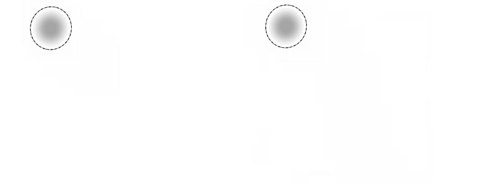
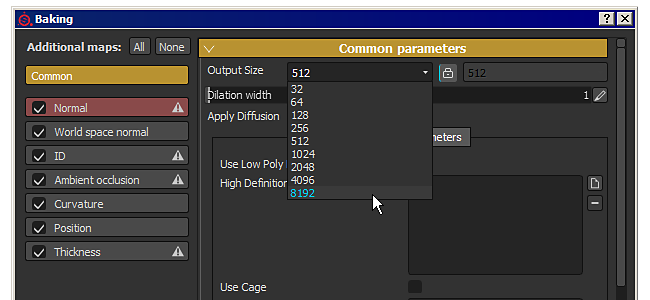
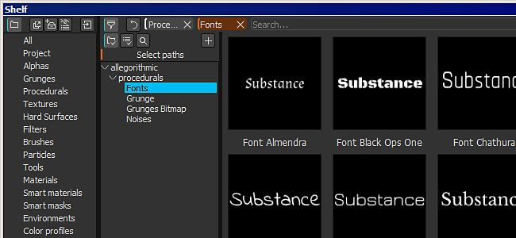
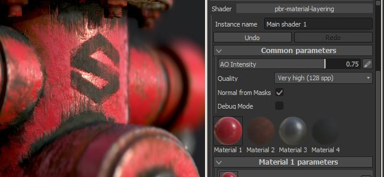

# Versión 2.5

**Substance Painter 2.5** presenta muchas características nuevas: desde el soporte de la opacidad en la configuración del pincel (además del flujo) a la capacidad de hacer un bake mapa adicional en 8K y mucho más.

Fecha de publicación : *21 de febrero de 2017*

## Funciones principales

### Nueva opacidad del pincel

{width="650px"}

Ahora hay una nueva configuración en los **parámetros de pincel** al pintar en Substance Painter que es la **opacidad**.\
La **opacidad** controla la **intensidad general de un trazo de pincel**, a diferencia de la configuración de **flujo**, que controla la intensidad de **cada sello individual** dentro de un trazo de pincel. Esto significa que ahora es posible pintura y repintar un mismo área **sin crear valores superpuestos**. Para ello, establezca el flujo en 100 y el valor de opacidad en la intensidad que prefiera. Debido a cómo funciona la opacidad, no es posible vincularla a la presión del lápiz. Para ese tipo de control el flujo sigue siendo la mejor opción.

También hemos agregado un **nuevo modificador** junto a este nuevo parámetro que está en la clave **&quot;A&quot;** de forma predeterminada. Si pulsa esta tecla, **podrá continuar con el trazo de pincel anterior** en lugar de crear uno nuevo. Esto significa que puede pintura un color uniforme con la opacidad que desee, al tiempo que mantiene la posibilidad de mover la cámara, por ejemplo. Otro ejemplo sería continuar la copia que estaba haciendo con la herramienta de clonación.

### Nuevo hacer un bake en resoluciones de 8K y no cuadradas

El baker se ha mejorado para admitir resoluciones de hasta **8192x8192** (8K más suavizado), lo que significa que ahora puede exportar a 8K con una proporción de 1:1 con los mapas adicionales.\
También hemos agregado compatibilidad para resoluciones **no cuadradas**. Ahora es posible hacer un bake una textura de **4096x2048**, por ejemplo. Para ello, solo tiene que hacer clic en el icono &quot;**lock**&quot; situado junto al menú desplegable para seleccionar la resolución.

### Nueva compatibilidad con el perfil de color en la ventana gráfica

Se ha agregado la compatibilidad de **LUT** (texturas) para controlar la representación del **puerto de visualización** en Substance Painter. Para aplicar un perfil, solo tiene que habilitar la opción &quot;**Perfil de color**&quot; en la ventana &quot;**Configuración de pantalla**&quot; y cargar la LUT en la ranura dedicada. Funciona tanto con la ventana gráfica **OpenGL** como con el procesador **IRay**. De forma predeterminada, hay disponibles algunos ejemplos, desde **ajustes preestablecidos de cámara** habituales hasta más **efectos artísticos**. Para obtener más información, consulte la página dedicada de la documentación : [Perfil de color](../../features/post-processing/color-profile.md)

### Nuevo motor Substance compatible con Substance Designer 6

Hemos agregado la compatibilidad con **Substance Designer 6**, lo que significa que los recursos creados con **SD6** se pueden abrir y usar en **Substance Painter 2.5** !\
Un buen ejemplo es la capacidad de usar el **nuevo nodo de texto** del SD6 e integrarlo en una sustancia. De esta manera, es posible crear **texto dinámico** y realizar la pintura directamente sin necesidad de salir de la aplicación. **Incluimos 10 fuentes** cada una con un estilo diferente de forma predeterminada para cubrir el uso más común. Las encontrarás en la sección &quot;**procedimienta**&quot; del **estante**.

{width="400px"}

### Nuevo contenido en el estante

Además de algunas correcciones y mejoras con el nuevo estante, también agregamos **nuevos filtros** para mejorar la pintura y la creación de texturas. También **mejoramos** el comportamiento de un filtro ya existente (como el &quot;**HSL**&quot;). También hemos agregado nuevas **plantillas** al crear **nuevos proyectos** (como **Unity 5** y **Unreal Engine 4**).

### Nuevas mejoras en los scripts compatibles con la interfaz de usuario de sombreador personalizada

Con esta versión, hemos añadido una forma de **script y control** de los **parámetros de sombreador**. También hemos agregado la compatibilidad para usar una **interfaz de usuario personalizada** en lugar de la predeterminada, lo que abre muchas posibilidades nuevas, como **sombreador animado**.\
Para obtener más información, consulte la documentación de secuencias de comandos disponible en el menú Ayuda de la aplicación.

## Tutorial

Las nuevas funciones principales se tratan en nuestro último flujo de Twitch :

## Notas de la versión

### 2.5.3

(Publicado el 15 de marzo de 2017)

**Solucionado :**

* [Baker] Bloqueo al hacer un bake con mallas específicas

**Problema conocido:**

* [Mac] Las partículas pueden dañar la textura en algunos casos

### 2.5.2

(Publicado el 14 de marzo de 2017)

**Solucionado :**

* [Herramienta] La tableta Wacom no funciona en Linux
* [Herramienta] Artefactos negros al utilizar la herramienta de difuminado
* [Baker] Se produce un error al Hacer un bake si se utiliza la coincidencia por nombre con una jaula
* [Bakeres] Oclusión ambiental rota al hacer un bake solo con Mapa de normales
* [Shelf] Los filtros genéricos no manejan alfa correctamente (contraste/luminosidad, paso alto, etc.)
* [Ventana gráfica] Problema de rendimiento al cargar un proyecto con sombras activadas
* [Ventana gráfica] Problema de tramado en Vista 3D en MacOS
* [Ventana gráfica] Las previsualizaciones de objetos se muestran incorrectamente cuando el perfil de color está activado
* [Iray] Bloqueo al volver a cambiar el proyecto a OpenGL si Iray no se inicializa
* El Brillo [IRay] se omite al procesar el sombreador SpecGloss/mdl
* [Sombreador] El sombreador Spec/Gloss no coincide con Iray y SD
* [Sombreador] La conversión de sRGB difiere de la conversión de LUT lineal a sRGB
* [Sombreador] Procesamiento incorrecto al cargar el proyecto con sombreadores obsoletos
* [Sombreador] Los sombreadores &quot;recubiertos de pbr&quot; ya no funcionan
* [Exportar] Algunos canales aún se exportan aunque no estén presentes en el conjunto de texturas
* [Capas] El modo de fusión &quot;mapa de normales de detalle inverso&quot; no funciona en canales en escala de grises
* [UI] Problema en &quot;Ventana de selección de color&quot; con monitor HDPI y zoom de visualización al 150 %

**Problema conocido:**

* [Mac] Las partículas pueden dañar la textura en algunos casos

### 2.5.1

(Publicado el 27 de febrero de 2017)

**Solucionado :**

* [Mac] La entrada de la tableta Wacom se rompe en 3D y Vista 2D
* [Bakeres] La coincidencia por nombre ya no funciona
* [Bakeres] El ajuste &quot;Normales medias&quot; ya no funciona
* [Iray] Procesamiento incorrecto con falta de mapa de normales hecho un bake
* [Iray] Los perfiles de color se comportan de forma diferente en comparación con el procesador OpenGL
* [Iray] Al exportar el procesamiento como mapa de bits, no se incluye la corrección del perfil de color
* [Substance] Los Filtros de material ya no funcionan
* [Herramienta] La opacidad del trazo no se almacena en los ajustes preestablecidos del pincel
* [Herramienta] La alineación UV del pincel del Clonar ya no funciona
* [Exportar] El canal de Desplazamiento debe estar centrado en 0,5 al exportar en entero
* [Plantilla] La ruta absoluta se almacena en Plantillas
* [TextureSet] La textura del canal se mantiene después de quitar el canal

**Problema conocido:**

* [Linux] La entrada de tabletas Wacom no funciona en 3D ni en Vista 2D
* [Mac] Las partículas pueden dañar la textura en algunos casos
* [Exportar] En casos muy raros, pueden aparecer rectángulos negros en las GPU AMD

### 2.5.0

(Publicado el 21 de febrero de 2017)

**Agregado :**

* Compatibilidad añadida para las GPU AMD Radeon Pro y AMD FirePro
* [Herramienta] Compatibilidad añadida con la opacidad del trazo
* [Herramienta] Agregue un modificador que permita continuar con el último trazo de pincel
* [Iray] Actualización compatible con las GPU Pascal
* [Ventana gráfica] Compatibilidad añadida con perfiles de color (LUT)
* [Substance] Integrar nueva estructura (motor SD6)
* [UI] Aumentar la lista de tamaño de &quot;archivo reciente&quot; en el menú Archivo
* [Importar] Utilice la categoría de sustancias para rellenar el prefijo en el cuadro de diálogo de importación
* [Bakeres] Permitir hacer un bake texturas 8K
* [Bakeres] Permitir hacer un bake resoluciones no cuadradas
* [Bakeres] Mejora el consumo de memoria al hacer un bake mallas pesadas de alto contenido de poli
* [Estante] Bloquear estantes (y proyectos) para prohibir la edición simultánea y evitar daños
* [Shelf] Lea la categoría y las palabras clave de las sustancias para usarlas para filtrar
* [Shelf] Permite excluir recursos del resultado de una consulta de búsqueda
* [Shelf] Cálculo del tiempo de las miniaturas mejorado
* [Estante] Permitir la incrustación de ajustes preestablecidos en proyectos
* [Estante] Permita contraer o expandir rápidamente la vista de árbol con MAYÚS
* [Estante] Permite guardar miniaturas cuando los recursos son de solo lectura (caché local)
* [Estante] Nuevo contenido : nuevos filtros (transformar, espejo, tri-plana, etc.)
* [Estante] Nuevo contenido : nuevos perfiles de LUT (clásicos y artísticos, como Film Noir, Vintage, etc.)
* [Estante] Nuevo contenido : 10 nuevos Substance de fuentes para generar rápidamente textos personalizados
* [Estante] Nuevas plantillas : Unity 5 y Unreal Engine 4
* [Estante] Se ha mejorado el filtro de HSL para que sea más fácil de usar por los artistas
* [Sombreador] Se ha agregado la compatibilidad con el canal de specular level en sombreadores PBR
* [Sombreador] Añadir soporte para tramado en sombreador de prueba de Alpha
* [Sombreador] Añadir compatibilidad para la asignación de oclusión de paralaje en sombreadores PBR
* [Sombreador] Permite definir una interfaz de usuario personalizada para los parámetros de sombreador.
* [MatLayering] Creación de un nuevo canal de máscara para el flujo de trabajo de capas de materiales
* [Scripting] Permita escribir metadatos en un proyecto de SP
* [Scripting] Permitir la exportación con un ajuste preestablecido de exportación específico
* [Scripting] Permite recuperar parámetros de sombreador como JSON
* [Scripting] Agregar compatibilidad para conexiones WebSocket
* [Scripting] Añadir la posibilidad de cargar instancias del sombreador
* [Scripting] Añadir la posibilidad de crear un nuevo proyecto
* [Scripting] Permite recuperar la URL de la malla importada en un proyecto
* [Scripting] Permitir hagas un bake no cuadrados
* [Scripting] Informar de errores al configurar datos mediante la API de scripts
* [Substance] Añadir etiqueta de datos de usuario para especificar el formato de mapa de normales

**Solucionado :**

* Bloqueo al elegir color con substancias
* Bloqueo al cargar una imagen que no es RGBA32f como mapa de entorno
* Bloqueo relacionado con la pintura en GPU AMD
* [Mesh] OBJ importación no reconoce materiales sin el archivo mtl
* [Mesh] La generación del nombre del conjunto de texturas del UDIM puede ser incorrecta en algunas mallas
* [UI] Botón Deshacer/Rehacer en la configuración del visor para robar el foco y detener el desplazamiento del ratón
* [UI] Algunas etiquetas se recortan incorrectamente en alta resolución
* [Capa] El modo de sustitución del efecto pintura se comporta de forma incorrecta en Máscara
* El modo de fusión de Restar [Layer] se comporta de forma incorrecta con alfa
* [Herramienta] El tamaño del pincel se vuelve enorme en vista 2D al pintar en bordes UV
* [Herramienta] La línea recta ajustada tiene un comportamiento errático con alta PPP
* [Herramienta] La resolución de la galería de símbolos a veces es incorrecta
* [Bakeres] Los valores de &quot;Distancia máxima del oclusor&quot; se fijan si &quot;relativo al cuadro delimitador&quot; está &quot;Desactivado&quot;
* [Sombreador] Las definiciones de canal de pilas y parámetros automáticos no coinciden
* [Vista 3D] Visualización incoherente del canal normal según la configuración del proyecto
* [Ventana gráfica] Algunos mapas de normales tienen valores sujetos que aparecen como artefactos
* [Ventana gráfica] Los efectos posteriores siempre están desactivados de forma predeterminada
* [Exportar] El ajuste de mezcla normal es incorrecto si falta un canal normal
* [Exportar] Generación de textura incorrecta en algunos casos en GPU AMD
* [Exportar] Los parámetros de Sombreador no se exportan correctamente si se encuentran dentro de un grupo
* [Exportar] Al editar un ajuste preestablecido de exportación en una estantería personalizada, se genera un error de registro
* [Shelf] El filtrado de vista de árbol no coincide exactamente con el nombre de la carpeta
* [Estante] Es difícil cambiar el nombre de un ajuste preestablecido de estante
* [Estante] El recurso de Sombreador importado en la Estantería no se conserva después de reiniciar
* [Estante] Contenido : Falta el ajuste preestablecido de la herramienta Soldadura
* [Estante] Contenido : El Tile Generator no funciona correctamente
* [Estante] Contenido : Se ha corregido una máscara incorrecta en el material inteligente sucio del neumático de goma
* [Estante] Contenido : Se ha corregido un nombre de grupo incorrecto en el material de la bolsa de cuero
* [Iray] La mitad de las mallas están desaparecidas en Irak
* [Linux] Bloqueo al arrastrar un recurso sobre la Vista 3D
* [Mac] Las preferencias se restablecen en cada inicio en Sierra

**Problema conocido:**

* [Exportar] En casos muy raros, pueden aparecer rectángulos negros en las GPU AMD
* [Iray] Los perfiles de color pueden comportarse de formas extrañas a veces
