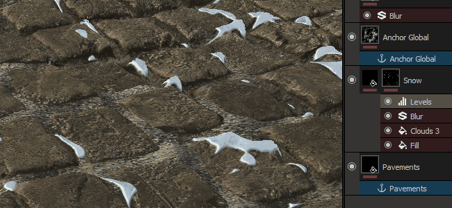

# Versión 2017.2

**Substance Painter 2017.2** presenta una nueva y potente característica a través del sistema de puntos de ancla. Permite crear configuraciones más avanzadas en la pila de capas, lo que abre muchas posibilidades nuevas.

Fecha de publicación : *27 de julio de 2017*

## Funciones principales

### Nuevo efecto Punto de anclaje

**Se ha agregado un nuevo tipo de efecto** al Substance Painter, junto a los ya existentes, como **Filtro** y **Nivel**, ahora puedes encontrar el nuevo **punto de anclaje**. Este nuevo efecto permite definir una **ubicación** en la **pila de capas** a la que se puede hacer **referencia** en el resto del proyecto en cualquier otra capa. Esto permite, por ejemplo, utilizar la información de height de una capa en la máscara de una capa justo encima de esta, lo que permite una fusión más natural (como se ilustra en el gif anterior).

Dado que Anchor funciona como un efecto, en se puede crear en **muchas situaciones** : el **contenido** de una capa, la **máscara** e incluso como un filtro de **paso a través**. El efecto también funciona aunque la capa en la que se encuentra esté desactivada. Tenga en cuenta que el anclaje sólo define una ubicación, no lo que se puede recuperar de ella. Esta información se define donde se crea la referencia al anclaje.

Para obtener más detalles técnicos y ejemplos, consulte la página dedicada : [Punto de anclaje](../../features/effects/anchor-point.md)

### Nuevas y diversas mejoras

Junto con el nuevo efecto Punto de anclaje, también trabajamos en :

* La capacidad de cambiar el nombre de algunos efectos, como Relleno y Pintura
* Nuevas funciones de secuencias de comandos, que permiten crear un vínculo interactivo con otras aplicaciones como Unity

## Tutorial

Las nuevas funciones se detallan en nuestros vídeos más recientes :

## Notas de la versión

### 2017.2

(Publicado el 27 de julio de 2017)

**Agregado :**

* [Efecto] Nuevo punto de anclaje que permite hacer referencia a capas y máscaras
* [Layers] Capacidad de renombrar efectos de relleno y Pintura
* [Plugin] Complemento de Substance Source actualizado
* [Scripting] Permitir consultar la resolución del conjunto de texturas
* [Scripting] Permite obtener el estado del motor de pintura
* [Performance] Mejoras en la carga de proyectos y en las optimizaciones de estampado de pinceles

**Solucionado :**

* [Herramienta] Problemas de rendimiento al ajustar parámetros de material
* [Motor] Trazos de pincel que desaparecen al cambiar la resolución (4K>2K)
* [Vista 3D] El espacio tangente no se sincroniza con los bakeres
* [Estante] La ruta de los estantes en los documentos de usuario no se crea automáticamente
* [Shelf] Hacer ajustes preestablecidos compatibles con versiones anteriores después de una actualización
* [Sombreador] El sombreador que no es PBR ya no funciona
* [Baker] Error al Hacer un bake la asignación de ID. si la opción Coincidir por nombre está activada
* [Ejemplo] Los nombres de los conjuntos de texturas del proyecto de muestra Meet Mat son incorrectos
* Guardar un proyecto antes de crear una plantilla devuelve errores de permisos de escritura
