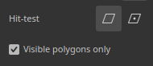

# Versión 12.2

**Substance 3D Painter 12.2** ofrece una herramienta mejorada de relleno poligonal con selección basada en bucle, pintura de jaula para hacer un bake, resaltado de conjuntos de texturas en la ventana gráfica y transparencia independiente del pedido para el procesamiento en tiempo real.

Fecha de publicación: **21 de octubre de 2026**

## Funciones principales

### Relleno poligonal mejorado

La herramienta **Relleno de polígono** se ha rediseñado con una nueva interfaz y nuevos modos de selección para bucles de polígono. La herramienta ahora también admite modos de fusión con un control de opacidad y puede funcionar en varios canales a la vez. La selección también controla la oclusión, lo que significa que los polígonos ocultos de la cámara se omiten.

* **Interfaz mejorada**

  La configuración de **Relleno poligonal** en la ventana **Propiedades** se ha rediseñado para que sea más fácil de usar. Las opciones ahora se muestran como filas de botones, lo que agiliza el cambio entre los modos. Los nuevos iconos de información sobre herramientas describen cómo funciona cada modo.

  

* **Nuevos modos de selección**

  Se han agregado dos nuevos modos dedicados a los bucles de polígono a la fila **Selection Mode**:

  

  * **Relleno de bucle de polígono**: este modo llena un bucle completo de quads con un solo clic. Si mantiene presionada la tecla **Alt** mientras arrastra, la selección también se extiende en la dirección opuesta.

    

  * **Relleno parcial de bucle de polígono**: este modo rellena solo una parte de un bucle y, al arrastrarlo, se amplía la selección. Al arrastrar, las flechas muestran el flujo de topología a cada lado de la selección para ayudar a anticipar cambios de ruta inesperados. La información sobre herramientas junto al cursor muestra el número de polígonos seleccionados en ambos ejes. Si mantiene presionada la tecla **Alt** mientras arrastra, la selección también se extiende en la dirección opuesta.

    

  Al mantener presionado **Mayús + A**, también se cambia temporalmente a **Relleno de bucle poligonal** desde cualquier modo de selección. Si se suelta el método abreviado antes del botón del ratón, la selección continúa hasta que se suelta el botón del ratón.

* **El modo de relleno cambia el modo de selección**

  Las opciones del **modo Relleno** no se aplican a los modos **Relleno de bucle de polígono** y **Relleno de bucle de polígono parcial**. Por esta razón, al seleccionar un modo de relleno, el **modo de selección** volverá automáticamente al modo principal.

  

* **Nueva opción de comprobación de visitas**

  La nueva opción **Hit-test** controla qué polígonos se incluyen en el área de selección. Descartar polígonos no visibles es ahora el comportamiento predeterminado, ya que la opción **Solo polígonos visibles** está habilitada de forma predeterminada. Al deshabilitar esta opción, se restaura el comportamiento anterior de rellenar la malla.

  Las opciones disponibles son:

  * **Intersección**: (valor predeterminado) un polígono se rellena si alguna parte del mismo se encuentra dentro del área de selección o cruza su borde.
  * **Centro contenido**: un polígono sólo se rellena si su punto central se encuentra dentro del área de selección.
  * **Solo polígonos visibles**: si está activada, esta opción rellena solo los polígonos visibles desde la vista de cámara actual. Por lo tanto, la geometría ocluida y la que mira hacia atrás se ignoran.

  

* **Modos de fusión y opacidad**

  La herramienta **Relleno poligonal** ahora admite todos los modos de fusión, la misma lista que la disponible en la pila de capas. Por ejemplo, **Sobreexposición lineal (Agregar)** agrega valores a los existentes en lugar de reemplazarlos. Los modos están disponibles en la nueva sección **Fusión** de la ventana **Propiedades**, además de un regulador **Opacidad**. En el modo **Material**, el modo de fusión se aplica a todos los canales habilitados en la sección **Material**.

  

* **Rellenar varios canales a la vez**

  La herramienta **Relleno poligonal** ya no está limitada a un solo canal. Todas las propiedades de canal habilitadas en la sección **Material** ahora se pueden establecer y rellenar en una sola acción.

  

* **Compatible con simetría**

  **Relleno de bucle de polígono** y **Relleno de bucle de polígono parcial** también funcionan con la simetría. Un solo clic funciona con la simetría espejo (sin embargo, la simetría radial podría ser menos fiable).

  

* **Reanudar trazo anterior**

  El método abreviado **Reanudar trazo anterior** (manteniendo **A** pulsado) ahora funciona con la herramienta **Relleno poligonal**, incluidos los modos de fusión y las opacidad.

  

* **Comentarios más claros en los conjuntos de texturas**

  La malla metálica ahora se muestra solo para el conjunto de texturas activo y se actualiza cuando cambia la selección. Al pasar el cursor por encima de la geometría de otro conjunto de texturas, se muestra un cursor prohibido para indicar que la geometría relacionada no se puede rellenar.

  

>[!NOTE]
>
> Para obtener más información sobre la herramienta **Relleno poligonal**, consulta la [página de documentación dedicada](https://experienceleague.adobe.com/en/docs/substance-3d-painter/using/painting/paint-tools/polygon-fill).

### Nueva pintura de jaula en modo de Hacer un bake

El nuevo **modo de pintura de jaula** es un desplazamiento de jaula por píxel que se puede pintar encima del desplazamiento de distancia global. Esto significa que la jaula ahora se puede ajustar pintando directamente en la malla. Las áreas donde la alta malla de polietileno va fuera de la jaula se pueden fijar localmente más fácilmente.

* **Nueva pintura del desplazamiento de la jaula**

  Un nuevo botón **jaula de Pintura** en modo de Haga un bake ahora cambia al modo de pintura de jaula. En este modo, se pueden usar las herramientas **Pintura**, **Borrador** y **Relleno poligonal** para ajustar la distancia de la jaula desde la malla de poli baja.

  

  Esto se hace pintando una textura intermedia. Esta textura se utiliza entonces como un desplazamiento en la malla de la jaula durante el hago un bake. Esto es similar al proceso de **pintura sesgada**.

  Un parámetro **Strength** en la barra de herramientas superior establece el valor de desplazamiento aplicado por el trazo. También están disponibles los controles habituales **Size**, **Flow**, **Stroke opacity** y **Spacing**, así como el botón **Invert value**. También se admite la simetría.

  

  

* **Usar Relleno poligonal para seleccionar y rellenar partes enteras de la malla**

  La herramienta **Relleno poligonal** puede ajustar la distancia de la jaula de subobjetos parciales o completos a la vez. Al hacer clic en un elemento, se abre una barra de herramientas flotante con un regulador **Intensidad de la jaula**. Este regulador aumenta o reduce la jaula en tiempo real, a partir del valor establecido en la barra de herramientas superior. Los desplazamientos pintados se añaden encima del desplazamiento.

  

* **Visualizar desplazamientos de jaula en la ventana gráfica**

  Al entrar en el modo de pintura de jaula, la ventana gráfica cambia a un nuevo modo de visualización. En este modo, los desplazamientos son visibles como una superposición verde sobre la jaula. La jaula también se deforma para representar la malla de la jaula utilizada durante el proceso de hacer un bake.

  

  Se pueden controlar algunas configuraciones a través del panel **Haciendo un bake visualización**: la sección **Cage** controla la **superficie Cage** y la **malla metálica Cage** y su opacidad. También tiene una **opacidad de cuadrícula de desplazamiento** y una intensidad de sombreado de desplazamiento **.**

  

* **Modo de fusión en la barra de herramientas contextual**

  Algunos modos de fusión están disponibles directamente dentro de la barra de herramientas contextual para mayor comodidad. Se pueden utilizar para ajustar el desplazamiento de la jaula más fácilmente, especialmente para añadir o restar desplazamientos.

  Los modos disponibles son:

  * **Normal**: reemplaza el desplazamiento existente por el valor de trazo.
  * **Aclarar (máx.)**: mantiene el valor más alto del trazo y el desplazamiento existente.
  * **Sobreexposición lineal (Agregar)**: (por defecto) añade el valor de trazo al desvío existente.

  

  Hay disponibles otros modos de fusión con **Relleno poligonal** haciendo clic con el botón derecho en el menú de la ventana gráfica.

* **Nuevo menú de restablecimiento para pintura en jaula y sesgada**

  El modo de sesgado y pintura de jaula ahora disponen de un nuevo menú para restablecer la configuración. Las opciones disponibles son:

  * **Restablecer parámetros de jaula/sesgo**: restablezca los parámetros de la interfaz de usuario a sus valores predeterminados.
  * **Borrar todos los trazos de pintura de jaula/sesgo**: borre la textura utilizada para la jaula o la pintura sesgada.
  * **Restablecer y borrar todo**: combine tanto el restablecimiento de la interfaz de usuario como el borrado de las texturas de jaula/sesgo.

  

>[!NOTE]
>
> Para obtener más información sobre cómo hacer un bake, consulte la [página de documentación dedicada](https://experienceleague.adobe.com/en/docs/substance-3d-painter/using/baking/baking).

### Nuevo resaltado de conjunto de texturas en la ventana gráfica

El nuevo comportamiento de resaltado ahora puede ayudar a identificar qué geometrías de la ventana gráfica 3D están asociadas a un **Conjunto de texturas** o a un **Mosaico de UV**.

* **Resaltar de la lista Conjunto de texturas**

  Al pasar el ratón por encima de una entrada en la **lista de conjuntos de texturas**, ahora se resalta su geometría en la ventana gráfica, tanto para los conjuntos de texturas como para los Mosaicos de UV. Esto facilita ver qué parte de la malla pertenece a cada conjunto de texturas.

  

* **Resaltar desde la ventana gráfica**

  Al mantener pulsado **Ctrl/Cmd + Alt** sobre el modelo, se realza la geometría del conjunto de texturas bajo el cursor. El resaltado se oculta mientras se presiona el botón izquierdo del ratón o durante la panorámica, y vuelve una vez que se sueltan los modificadores.

* **Disponible en los modos de pintar y Hacer un bake**

  El resaltado funciona tanto en los modos de pintar como de hacer un bake. En el modo hacer un bake, los conjuntos de texturas desactivados se muestran en gris al resaltarlos.

### Nueva transparencia independiente del pedido

La ventana gráfica en tiempo real ahora admite la transparencia independiente del pedido. Elimina los defectos de ordenación y el parpadeo que pueden aparecer cuando varias superficies transparentes o translúcidas se superponen.

* **Nueva opción en la configuración de visualización**

  La opción **Transparencia independiente del pedido** se puede habilitar dentro de la sección **Configuración de procesamiento** de **Configuración de pantalla**. De forma predeterminada, está desactivada para evitar que el rendimiento se vea afectado.

  

  Antes y después de activar la nueva configuración:

  

* **Control de rendimiento**

  Un parámetro **Sort Capacity** controla el promedio de capas de transparencia que se pueden ordenar por píxel. Los valores más altos mejoran la calidad de la transparencia en escenas complejas, pero pueden utilizar más memoria y reducir el rendimiento. Las opciones disponibles son:

  * **Bajo (1x)**.
  * **Medio (2x)**.
  * **Alta (4x)** (predeterminada)
  * **Muy alto (8x)**
  * **Ultra (16x)**

### Mejoras diversas

Se han añadido funciones y mejoras adicionales en esta versión:

* **Ajustes de visualización reorganizados**

  Los parámetros de la ventana **Display Settings** se han reagrupado y reordenado para que el panel sea más fácil de navegar. La configuración ahora está dividida en **Configuración del entorno**, **Configuración de la cámara**, **Efectos de posprocesamiento**, **Configuración de procesamiento** y **Configuración de visualización**. Una fila de botones en la parte superior de la ventana permite saltar directamente a cada grupo.

  

* **Fusión aditiva con trazos de pincel**

  La configuración del pincel ahora ofrece un nuevo modo de fusión aditivo. Con este modo, los trazos se añaden unos encima de otros en la misma capa, en lugar de sustituirse entre sí. Esto no se limita a los sellos dentro de un trazo. Con este nuevo modo, el color se puede añadir aditivamente o el canal de height se puede esculpir añadiendo o eliminando valores.

  

* **Nuevo mapa del motor vecino UV**

  Hay disponible una nueva entrada de mapa del motor `mesh_uv_neighbor` para los materiales y filtros de Substance. Funciona como una textura de advección UV para encontrar el otro lado de una costura de Isla de UV. Sus canales rojo y verde almacenan la advección UV utilizada para alcanzar el píxel vecino a través de una costura UV.

  Para obtener más información sobre estas texturas del motor, consulte la [página de documentación dedicada](https://experienceleague.adobe.com/en/docs/substance-3d-painter/using/content/creating-custom-effects/mesh-based-input).

## Notas de la versión

### 12.2.0

Fecha de publicación: **2026/10/21**

Resumen: **Esta actualización es una versión importante, agrega una nueva característica de pintura en jaula para hacer un bake y mejora la funcionalidad de relleno de polígono. Para obtener más detalles, vea las notas de la versión completas.**

**Agregado:**

* Hacer un bake, Jaula
* &amp;lbrack;Pintura de jaula&amp;rbrack; Crear interfaz de usuario básica de Pintura de jaula
* &amp;lbrack;Pintura de jaula&amp;rbrack; Nuevas opciones de visualización de jaulas
* &amp;lbrack;Pintura de jaula&amp;rbrack; Herramienta Selección/Relleno editable
* &amp;lbrack;Pintura de jaula&amp;rbrack; Mostrar modo de Fusión en la barra de herramientas
* &amp;lbrack;Pintura de jaula&amp;rbrack; HDR. cambios de IU del regulador
* &amp;lbrack;Pintura de jaula&amp;rbrack; Sombreador de visualización
* &amp;lbrack;Pintura de jaula&amp;rbrack; Restablecer opciones de pila
* Mejoras de la herramienta Relleno poligonal
* &amp;lbrack;Relleno poligonal&amp;rbrack; Añadir parche de polígono
* &amp;lbrack;Relleno poligonal&amp;rbrack; Añadir bucle de polígono
* &amp;lbrack;Relleno poligonal&amp;rbrack; Compatibilidad de simetría con Bucle/Parche
* &amp;lbrack;Relleno poligonal&amp;rbrack; Vista previa de borde de simetría
* &amp;lbrack;Relleno poligonal&amp;rbrack; Eliminar triángulos con bucles y bucles parciales
* &amp;lbrack;Relleno poligonal&amp;rbrack; Malla metálica visible solo para el conjunto de texturas activo
* &amp;lbrack;Relleno poligonal&amp;rbrack; Resaltado de borde rojo en triángulos que no se pueden hacer clic
* &amp;lbrack;Relleno poligonal&amp;rbrack; No desactive las opciones del modo de relleno
* &amp;lbrack;Relleno poligonal&amp;rbrack; Permitir definir todas las propiedades de canal con Relleno poligonal
* &amp;lbrack;Relleno poligonal&amp;rbrack; El trazo anterior de la reanudación funciona con el relleno poligonal
* &amp;lbrack;Relleno poligonal&amp;rbrack; Mostrar el cursor prohibido en conjuntos de texturas no activos
* &amp;lbrack;Relleno poligonal&amp;rbrack; Previsualización instantánea ALT
* &amp;lbrack;Relleno poligonal&amp;rbrack; Método abreviado para cambiar temporalmente a Polyloop (MAYÚS+A)
* &amp;lbrack;Viewport&amp;rbrack; Mostrar conjunto de texturas/resaltado de selección de Mosaico de UV
* &amp;lbrack;Viewport&amp;rbrack; Añadir soporte para Transparencia Independiente de Pedidos en la ventana gráfica en tiempo real
* &amp;lbrack;Configuración de visualización&amp;rbrack; Reorganizar la configuración de visualización en nuevos grupos
* &amp;lbrack;Herramienta&amp;rbrack; Añadir compatibilidad con la fusión aditiva con trazos de pincel
* &amp;lbrack;Herramienta&amp;rbrack; Añadir compatibilidad con la fusión aditiva con relleno poligonal
* &amp;lbrack;USD&amp;rbrack; Las USD exportadas con mapa de opacidad se vuelven transparentes en Arnold
* &amp;lbrack;Nvidia&amp;rbrack; Agregar advertencia sobre los controladores más recientes de NVIDIA (616.56 a 617.14)
* Añadir nueva entrada de mapa del motor &quot;mesh_uv_next&quot;
* Actualizar bakeres a la versión 3.23.0
* Actualizar el motor de Substance a la versión 9.6.1

**Corregido:**

* &amp;lbrack;Haciendo un bake&amp;rbrack; La oclusión ambiental Ignorar cara posterior por nombre de malla no funciona
* &amp;lbrack;Haciendo un bake&amp;rbrack; &amp;lbrack;AMD&amp;rbrack; Dispositivo perdido al hacer un bake con mallas de polietileno altas y pesadas
* &amp;lbrack;Performance&amp;rbrack; Uso de cerdos VRAM Painter
* &amp;lbrack;Viewport&amp;rbrack; Faltan texturas al abrir proyectos en pantallas HDPI
* &amp;lbrack;Herramienta&amp;rbrack; El modo de fusión aparece atenuado al pintar en una máscara
* Carpetas temporales no eliminadas después de la exportación en la red
* &amp;lbrack;USD&amp;rbrack; La geometría de USD exportada se divide a lo largo de los bordes UV
* &amp;lbrack;USD&amp;rbrack; Bloqueo al cargar USDz mal formado
