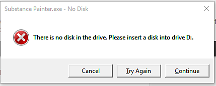

# Error: no hay ningún disco en la unidad

En Windows, a veces se produce este error:

&quot;No hay ningún disco en la unidad. Inserte un disco en la unidad X&quot;.

Hay algunas cosas que debe comprobar para deshacerse de este error:

* Compruebe que la configuración de las letras de unidad es correcta (consulte <https://support.microsoft.com/en-us/kb/330137> )
* Verifique que cualquier ubicación anterior utilizada en Substance 3D Painter sea válida (como la lista &quot;Archivos recientes&quot;)
