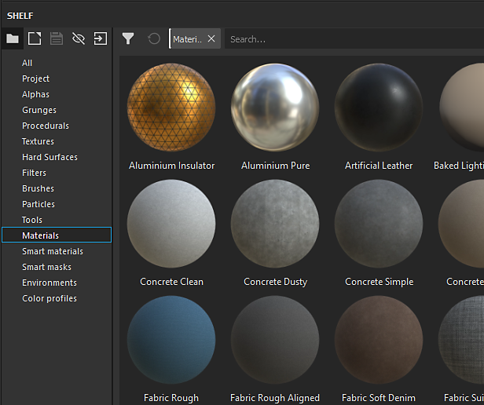
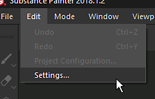

# Las miniaturas del estante tienen un aspecto incorrecto

Si las miniaturas de la estantería parecen ser diferentes de lo habitual, puede deberse al sombreador utilizado para procesar las previsualizaciones.

| Miniaturas rotas | Miniaturas normales |
| --- | --- |
| 

 | 

 |

## 1 - Abra la ventana de configuración principal

Ve a **Editar** y haz clic en **Configuración** :

## 2 - Retire el sombreador de vista previa de la plataforma

En la vista **General**, desplácese hacia abajo hasta que esté visible la sección &quot;Opciones de vista previa&quot;.\
Haga clic en el botón **cross** situado delante del &quot;**Sombreador de previsualización de material**&quot; para quitar el sombreador especificado actualmente.

{width="450px"}

## 3 - Reinicie Substance 3D Painter

Para regenerar las miniaturas de modo que tengan el aspecto correcto, Substance 3D Painter debe reiniciarse.
